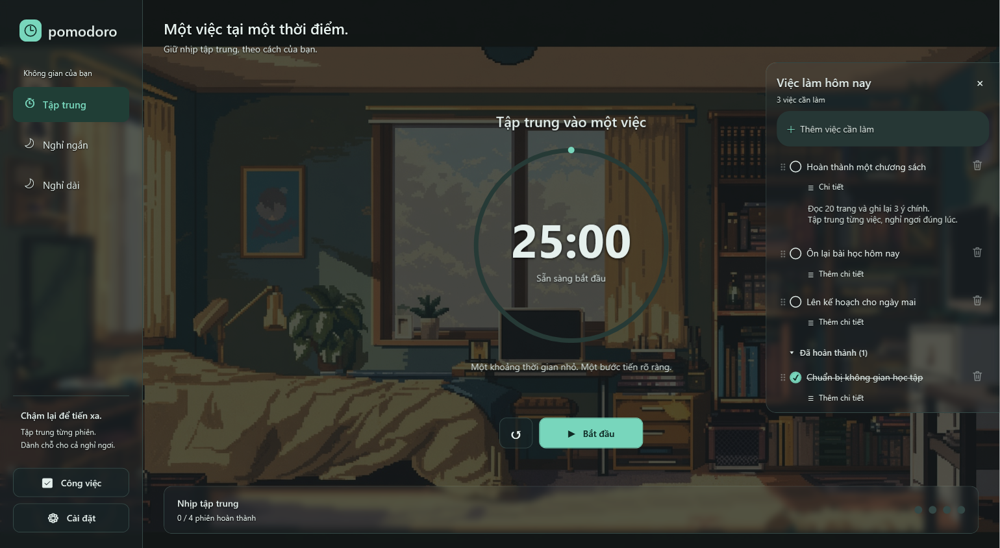
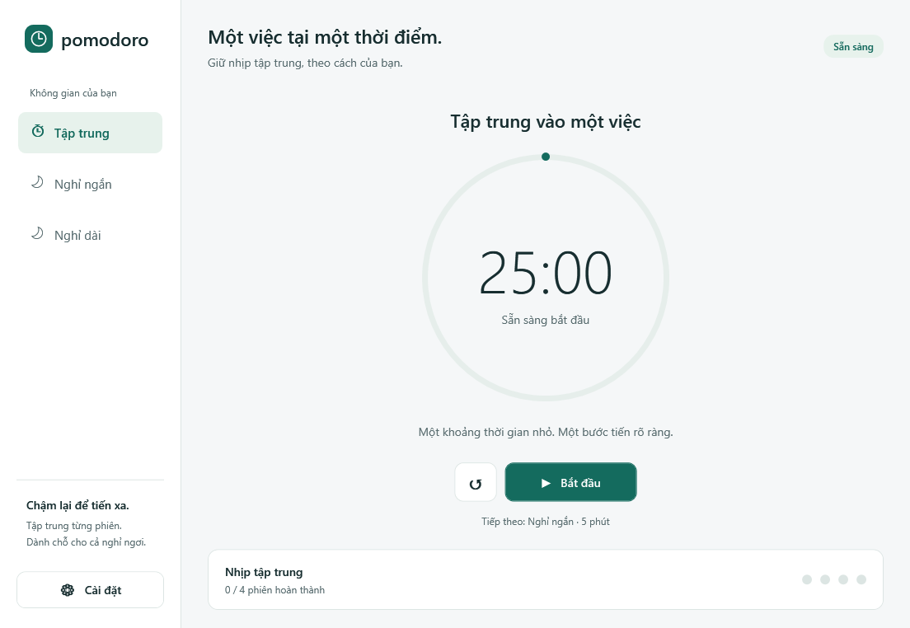
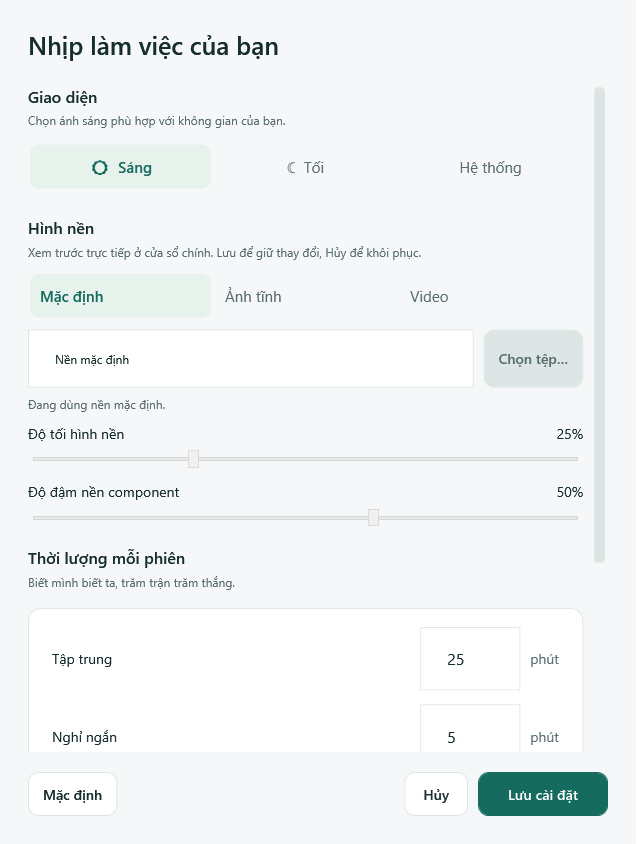
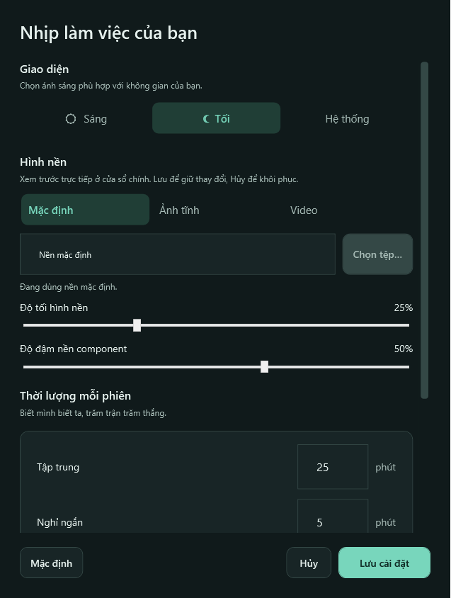

# Pomodoro

Ứng dụng đồng hồ Pomodoro cho Windows, viết bằng **C# / WPF / .NET 10**. Giao diện tiếng Việt với ba chế độ tập trung, nghỉ ngắn và nghỉ dài.



## Tính năng

- Đồng hồ đếm ngược với vòng tiến trình, nút bắt đầu, tạm dừng, tiếp tục và đặt lại phiên.
- Thanh chọn chế độ, thông tin phiên tiếp theo và tiến trình chu kỳ 4 phiên.
- Thời lượng mặc định **25 / 5 / 15 phút**, tùy chỉnh từ **1 đến 180 phút**.
- Chuông MP3 khi hết giờ; chuyển phiên khi chuông kết thúc hoặc khi bấm nút.
- Lưu thời lượng và lựa chọn nhạc chuông qua các lần mở ứng dụng.
- Bố cục co giãn, cài đặt có cuộn, điều khiển bằng bàn phím.
- Giao diện **Sáng / Tối / Hệ thống**, xem trước tức thì và lưu lựa chọn.
- Hình nền ảnh/video tùy chỉnh, lớp nền blur cho các bảng và bóng chữ theo theme.
- Danh sách công việc có ghi chú sửa trực tiếp dưới tên, kéo thả sắp xếp, nhóm đã hoàn thành và animation chuyển trạng thái.
- Toàn màn hình bằng **F11 / Alt + Enter**; nền chọn chế độ trượt theo nút được chọn.
- Trình phát MP3 ở thanh bên với **Music list**, kéo thả cả hàng, ba chế độ phát, tên bài chạy từ trái sang phải và 12 cột phổ âm thanh theo nhạc bằng NAudio.

Ảnh giao diện được render từ bản Release ngày **22/11/2026**, sử dụng công việc mẫu. Ảnh minh họa bố cục và hình nền; chưa phản ánh Music list, ghi chú sửa trực tiếp và các cập nhật giao diện ngày **23/11/2026**.

## Yêu cầu

- **Windows**, vì ứng dụng sử dụng WPF.
- **.NET 10 SDK** để chạy từ mã nguồn; kiểm tra bằng `dotnet --version`.
- Nếu dùng Visual Studio: phiên bản hỗ trợ .NET 10 và workload **.NET desktop development**.

## Chạy dự án

Mở terminal tại thư mục chứa `Pomodoro.slnx`:

```powershell
dotnet restore .\Pomodoro\Pomodoro.csproj
dotnet run --project .\Pomodoro\Pomodoro.csproj
```

Hoặc mở solution bằng Visual Studio, chọn `Pomodoro` làm startup project và nhấn **F5**.

Biên dịch Release:

```powershell
dotnet build .\Pomodoro\Pomodoro.csproj -c Release
```

Kết quả nằm trong `Pomodoro/bin/Release/net10.0-windows/`. Khi chuyển bản build sang máy khác, giữ nguyên các tệp đi kèm và thư mục `Assets`; máy đích cần **.NET 10 Desktop Runtime**.

## Publish

Xuất bản Release vào thư mục riêng, đồng thời tách kết quả biên dịch vào `artifacts`:

```powershell
dotnet publish .\Pomodoro\Pomodoro.csproj -c Release --artifacts-path .\artifacts\publish-build -o .\artifacts\publish-current --no-self-contained
```

Chạy `artifacts/publish-current/Pomodoro.exe`. Đây là bản phụ thuộc runtime: máy đích cần **.NET 10 Desktop Runtime**. Khi phân phối, sao chép toàn bộ thư mục publish, bao gồm `Assets`, các tệp DLL và cấu hình runtime.

Các thư mục `artifacts/` và `artifact/` chứa kết quả build, bản xem trước và dữ liệu sinh ra khi kiểm tra, được bỏ qua trong Git.

Profile `Pomodoro/Properties/PublishProfiles/FolderProfile.pubxml` hiện trỏ đến `D:\myApp\pomodoro`, là đường dẫn trên máy phát triển. Có thể sửa `PublishDir` trước khi publish bằng profile trên máy khác. Đóng app trước khi thay các tệp của bản đang cài; cài đặt và danh sách công việc lưu riêng trong LocalAppData.

## Sử dụng

1. Chọn **Tập trung**, **Nghỉ ngắn** hoặc **Nghỉ dài**, rồi bấm **Bắt đầu**.
2. Bấm **Tạm dừng / Tiếp tục** để điều khiển bộ đếm. Nút **↺** đưa phiên hiện tại về thời lượng ban đầu và chờ bạn bắt đầu lại.
3. Mở **Cài đặt**, nhập thời lượng, chọn chuông nếu cần, rồi bấm **Lưu cài đặt**. Nút **Mặc định** chỉ điền lại các giá trị trong cửa sổ; **Hủy** không thay đổi cấu hình đang dùng.
4. Khi hết giờ, bấm **Sang phiên tiếp theo** hoặc đợi chuông phát xong. Phiên tiếp theo trong chu kỳ bắt đầu tự động.

Đổi sáng/tối trong **Cài đặt → Giao diện**. Chọn **Sáng**, **Tối** hoặc **Hệ thống** để theo giao diện ứng dụng của Windows, rồi bấm **Lưu cài đặt**. Thay đổi được xem trước ngay; **Hủy** khôi phục giao diện đã lưu. Đổi giao diện không đặt lại bộ đếm.

| Giao diện sáng | Giao diện tối |
| --- | --- |
|  |  |

Chu kỳ:

```text
Tập trung → Nghỉ ngắn → Tập trung → Nghỉ ngắn
         → Tập trung → Nghỉ ngắn → Tập trung → Nghỉ dài → lặp lại
```

Nghỉ dài sau **4 phiên tập trung hoàn thành**. Chọn chế độ bằng tay hoặc đặt lại phiên không xóa số phiên đã hoàn thành trong chu kỳ. Tiến trình chu kỳ được giữ trong lần chạy hiện tại.

| Phím tắt | Thao tác |
| --- | --- |
| Space | Bắt đầu / tạm dừng khi vùng đồng hồ được chọn; trên nút, kích hoạt nút đang có focus |
| Ctrl + R | Đặt lại phiên |
| Ctrl + , | Mở cài đặt |
| F11 / Alt + Enter | Bật hoặc tắt toàn màn hình; khôi phục vị trí, kích thước và trạng thái cửa sổ trước đó khi thoát |
| Tab / Shift + Tab | Di chuyển giữa các điều khiển |
| Enter trong ô thêm công việc | Thêm task mới |
| Alt + ↑ / ↓ khi tay nắm task có focus | Sắp xếp task trong cùng nhóm |
| Esc khi kéo task | Hủy kéo, giữ thứ tự cũ |
| Esc trong cài đặt | Hủy và đóng |

Viền focus được giới hạn cho điều hướng **Tab / Shift + Tab** trong ứng dụng. Bấm chuột hoặc chuyển cửa sổ bằng **Alt + Tab** sẽ ẩn viền. Viền này khác với nền đánh dấu chế độ đang chọn; nền chọn vẫn hiện và trượt giữa ba nút chế độ.

## Cài đặt và hành vi bộ đếm

| Cài đặt — giao diện sáng | Cài đặt — giao diện tối |
| --- | --- |
|  |  |

- Cấu hình được lưu ở `%LOCALAPPDATA%/Pomodoro/settings.json`. Tệp cấu hình thiếu hoặc không đọc được không ngăn ứng dụng khởi động.
- Nhạc chuông tùy chọn được tham chiếu tại vị trí bạn chọn. Nếu tệp không còn tồn tại lúc mở ứng dụng, chuông mặc định sẽ được dùng.
- Mở cài đặt tạm dừng bộ đếm và chặn tự chuyển phiên; đóng cài đặt khôi phục trạng thái trước đó.
- Nếu chỉ đổi chuông hoặc thời lượng của chế độ khác, phiên hiện tại giữ nguyên thời gian còn lại. Đổi thời lượng của chế độ đang mở sẽ đặt lại bộ đếm và giữ trạng thái chạy / tạm dừng.
- Nếu chuông bị thiếu hoặc trình phát báo lỗi lúc hết giờ, ứng dụng chuyển sang phiên tiếp theo. Chuông mặc định là `Assets/Sounds/alarm_sound.mp3`.
- Thời gian còn lại được tính bằng đồng hồ đơn điệu; nhịp cập nhật giao diện không quyết định độ chính xác của bộ đếm.

## Cấu trúc mã nguồn

```text
Pomodoro.slnx
Pomodoro/
├── App.xaml[.cs]                    Khởi động và vòng đời ứng dụng
├── Shell/
│   ├── MainWindow.xaml[.cs]          Bố cục và điều phối chu kỳ
│   ├── MainWindow.ModeTransition.cs Animation nền chọn chế độ
│   └── MainWindow.FullScreen.cs     Toàn màn hình và khôi phục cửa sổ
├── Features/
│   ├── Timer/
│   │   ├── Controls/TimerDisplay.*  Toàn bộ cụm đồng hồ dùng chung
│   │   ├── Pages/                   WorkPage, RestPage, LongRestPage, TimeUpPage
│   │   ├── CountdownSession.cs      Tính thời gian bằng đồng hồ đơn điệu
│   │   ├── TimerPage.cs             Vòng đời bộ đếm dùng chung
│   │   └── ITimerControl.cs         Giao tiếp điều khiển bộ đếm
│   ├── Background/
│   │   ├── BackgroundController.cs  Vòng đời ảnh/video nền
│   │   ├── WallpaperBackdrop.cs     Lấy đúng vùng nền đã render để blur
│   │   └── BackgroundOptions.cs     Loại nền và thông số hiển thị
│   ├── Todo/
│   │   ├── TodoListView.xaml[.cs]   Danh sách, chi tiết và kéo thả task
│   │   ├── TodoListView.Motion.cs   Animation thêm task và dịch chuyển bố cục
│   │   ├── TodoListView.Completion.cs Chuyển trạng thái hoàn thành/bỏ hoàn thành
│   │   ├── TodoListView.Drag.cs     Bản kéo nổi, khoảng trống và tự cuộn
│   │   ├── InlineDetailsEditor.xaml[.cs] Ghi chú sửa trực tiếp, tự co giãn và chuyển mờ
│   │   ├── TodoItem.cs              Dữ liệu công việc và thông báo thay đổi
│   │   └── TodoStore.cs             Lưu danh sách JSON
│   ├── Music/
│   │   ├── MusicPlayerView.xaml[.cs] Box nhạc, Music list và nền chọn chế độ trượt
│   │   ├── MusicPlayerView.Reorder.cs Kéo thả, tự cuộn và animation sắp xếp
│   │   ├── MarqueeText.cs           Tên file chạy từ trái sang phải
│   │   ├── MusicLibrary.cs          Đường dẫn MP3, lưu JSON và dọn file mất
│   │   ├── MusicPlayback.cs         Phát/tạm dừng và giải phóng NAudio
│   │   ├── SpectrumSampleProvider.cs Phân tích FFT từ luồng đang phát
│   │   └── SpectrumView.cs          Vẽ cột nhạc theo theme
│   └── Settings/
│       ├── SettingsWindow.xaml[.cs] Cửa sổ cài đặt và xem trước
│       ├── AppSetting.cs            Đọc, kiểm tra và lưu cấu hình
│       └── SettingsData.cs          Dữ liệu JSON
├── Themes/
│   ├── Theme.xaml                  Style giao diện dùng chung
│   ├── ThemeManager.cs             Palette sáng/tối và theo dõi Windows
│   ├── ThemeResources.cs           Nạp resource dictionary
│   ├── WallpaperText.cs            Tắt bóng chữ trên các bề mặt điều khiển đặc
│   ├── KeyboardFocusFeedback.cs    Phân biệt Tab trong app với Alt+Tab/chuột
│   └── AppTheme.cs                 Lựa chọn theme
├── Services/Alarm.cs                Phát chuông MP3
├── Assets/Images/                   Ảnh đóng gói
├── Assets/Sounds/                   Âm thanh đóng gói
└── Properties/                      Assembly metadata và publish profiles
tests/Pomodoro.BackgroundTests/
tests/Pomodoro.TodoTests/
tests/Pomodoro.MusicTests/
docs/screenshots/
```

Namespace đi theo thư mục, ví dụ `Pomodoro.Features.Timer.Controls`. File XAML và code-behind đặt cạnh nhau; tên page/window dùng PascalCase. `MainWindow` điều phối chuyển phiên; các page dùng chung `TimerDisplay` và `TimerPage`. Các thiết lập người dùng vẫn lưu tại vị trí LocalAppData cũ, giữ nguyên định dạng JSON và đường dẫn media tùy chỉnh.

Các ảnh nền cũ trong `Assets/Images/` được giữ lại trong dự án. Mặc định giao diện dùng bảng màu sáng/tối; người dùng có thể chọn hình nền riêng trong Cài đặt.

## Danh sách công việc

- Bảng **Việc làm hôm nay** rộng 360 DIP, nằm nổi ở mép phải và đè lên grid giữa. Ẩn/hiện bảng không làm co giãn đồng hồ. Giữ bo góc trái, blur radius 16 và lớp phủ theo theme; dùng chung nguồn ảnh/video hiện có. Các lớp blur lấy đúng vùng từ viewport nền đã render bằng `VisualBrush`, cập nhật tọa độ sau layout và lấy thêm pixel xung quanh mép để tránh đường nối. Không còn đặt các bản Image toàn màn hình bằng Canvas.Left/Top.
- Nhập tên vào thanh **Thêm việc cần làm**, nhấn **Enter** hoặc **↵** để thêm. Chữ gợi ý ẩn khi ô nhập có focus; con trỏ nhập màu trắng. Task mới hiện nhẹ và trượt vào vị trí trong 180 ms. Checkbox tròn đánh dấu hoàn thành, **icon thùng rác** xóa task. Bấm **Chi tiết** hoặc nội dung ghi chú ngay dưới tên task để sửa trực tiếp; **Enter** xuống dòng, bấm ra ngoài hoặc **Ctrl+Enter / Esc** kết thúc nhập và giữ nội dung. Ô ghi chú co giãn và chuyển mờ nhẹ trong 160 ms, theo tùy chọn chuyển động của Windows. Ghi chú tự lưu và được ghi ngay khi đóng ứng dụng.
- Danh sách cuộn bằng con lăn/touchpad, thanh cuộn ẩn. Kéo tay nắm **⠿**: bản xem trước đi theo chuột, các task xung quanh trượt nhường khoảng trống; thả xuống để xác nhận và lưu. Thả ra ngoài hoặc nhấn **Esc** để hủy; kéo sát mép để tự cuộn. **Alt+↑/↓** sắp xếp bằng bàn phím. Chỉ cập nhật thứ tự dữ liệu khi thả, không ghi tệp liên tục lúc kéo.
- Công việc hoàn thành nằm trong nhóm **Đã hoàn thành (n)** mặc định thu gọn. Khi đánh dấu hoặc bỏ hoàn thành, task mờ dần và trượt nhẹ trong 170 ms trước khi chuyển nhóm; các task còn lại dịch chuyển lấp khoảng trống. Task ở nhóm đích hiện vào nhẹ nếu nhóm đó đang mở. Trạng thái được lưu ngay, không chờ animation kết thúc. Có thể mở nhóm đã hoàn thành để xem, sắp xếp hoặc đánh dấu lại. Animation dùng API WPF sẵn có, tự tắt khi Windows giảm chuyển động hoặc bật High Contrast.
- Tên, chi tiết, trạng thái và thứ tự được lưu ở `%LOCALAPPDATA%/Pomodoro/todos.json`, riêng với cài đặt bộ đếm. Lỗi lưu có thông báo và nút thử lại; nội dung vẫn giữ trong bộ nhớ.
- Nút **Công việc** ở thanh bên và **×** ở đầu bảng dùng để ẩn/hiện. Cửa sổ hẹp mặc định thu gọn bảng, khi mở vẫn dùng dạng nổi. Chuyển chế độ không tạo lại danh sách; Space và Ctrl+R trong bảng không điều khiển bộ đếm.

## Hình nền tùy chỉnh

Khi có ảnh/video nền, chữ dùng bóng tối nhỏ; số đồng hồ có hiệu ứng rõ hơn. Ở giao diện **Sáng** với hình nền, chữ và icon trên các bề mặt phủ nền chuyển sang **trắng**, các bề mặt điều khiển dùng màu đủ tương phản. Hiệu ứng áp dụng cho lớp chữ, không làm mờ cả component. Trở về nền mặc định sẽ khôi phục màu chữ theo theme và tắt bóng chữ; cửa sổ Cài đặt và bảng nhạc đặc vẫn dùng palette riêng theo theme. Các tham số nằm trong `Themes/ThemeManager.cs` (`CreateTextShadow`), style dùng chung trong `Themes/Theme.xaml`.

- Trong **Cài đặt → Hình nền**, chọn **Mặc định** hoặc **Ảnh / Video**. Hộp **Chọn tệp…** hiển thị chung ảnh JPG/JPEG, PNG và video MP4/WMV/AVI/MOV/M4V/MKV/WebM; ứng dụng tự nhận loại nền theo phần mở rộng. Có thể đổi trực tiếp từ ảnh sang video hoặc ngược lại. Hủy hộp chọn tệp giữ nguyên nền đang xem trước.
- Thay đổi hiển thị trực tiếp ở cửa sổ chính, phủ cả thanh bên và giữ tỉ lệ khi cắt phần dư. **Lưu cài đặt** xác nhận; **Hủy**, Escape hoặc đóng Cài đặt khôi phục nền trước khi mở. Chọn **Mặc định** ở mục Hình nền chỉ đặt lại nền; nút **Mặc định** dưới cùng đặt lại toàn bộ cài đặt đang xem trước.
- **Độ tối hình nền** từ 0–85%; **Độ đậm nền component** từ 0–80%. Độ đậm thấp giúp nhìn rõ video nhưng cần chọn nền phù hợp để chữ dễ đọc. Chỉ brush nền có độ trong suốt; chữ và biểu tượng giữ độ đậm đầy đủ. Các trạng thái hover, nhấn, focus, selected và disabled dùng màu riêng, không làm mờ cả nút. Thanh bên và thanh Nhịp tập trung có lớp blur nền riêng, dùng chung nguồn video.
- Loại nền, đường dẫn gốc và thông số hiển thị được lưu trong JSON hiện có, tương thích với cấu hình cũ. Ứng dụng không sao chép, chuyển đổi hoặc nén tệp. Giữ tệp ở vị trí đã chọn; tệp mất, đổi tên, thay đổi hoặc không đọc/phát được sẽ trở về nền mặc định kèm thông báo. Lựa chọn lỗi không tự ghi đè cấu hình đã lưu; có thể Lưu nền mặc định hoặc chọn tệp mới.
- Video dùng duy nhất một `System.Windows.Media.MediaPlayer` ở cửa sổ chính, đọc dần từ URI tệp. Chuyển phiên, đổi theme hoặc chỉnh độ tối/đậm không tạo lại trình phát hay đặt lại vị trí video. Video tự phát, lặp lại và luôn `IsMuted=true`, `Volume=0`; không dùng chung bộ phát chuông.
- Thu nhỏ cửa sổ tạm dừng video; khôi phục tiếp tục tại vị trí cũ. Khi Windows tắt **Animation effects** (`SystemParameters.ClientAreaAnimation`) hoặc bật High Contrast, video dừng ở một khung hình. Thay đổi tùy chọn hệ thống được theo dõi khi ứng dụng đang chạy.
- Không giới hạn thời lượng. Gợi ý clip 10–60 giây, 720p/1080p, 30fps. Thời gian chờ mở tệp là 15 giây, độc lập với thời lượng video. Đổi/bỏ nền hoặc đóng cửa sổ gọi `MediaPlayer.Close()`, bỏ ảnh và hủy theo dõi tệp để giải phóng decoder và khóa tệp; ảnh được giải mã rồi đóng stream ngay.
- Ưu tiên MP4 với H.264. Phần mở rộng MP4 không bảo đảm phát được: hỗ trợ thực tế phụ thuộc codec và thành phần media trên Windows. Các tệp WMV/AVI/MOV/M4V/MKV/WebM cũng được phép chọn để thử; ứng dụng kiểm tra `MediaOpened`, nội dung video và `MediaFailed`, không cam kết hỗ trợ tất cả codec. Tham khảo [Multimedia Overview của WPF](https://learn.microsoft.com/en-us/dotnet/desktop/wpf/graphics-multimedia/multimedia-overview).

## Nghe nhạc

- Bấm **+** trong box dưới **Nghỉ dài** để mở **Music list**. Bảng đóng khi bấm ra ngoài hoặc nhấn **Esc**.
- Trong **Music list**, bấm dấu **+** cạnh tiêu đề để thêm một hoặc nhiều MP3. Bấm tên bài hoặc nút tròn để phát/tạm dừng; mỗi bài có sóng âm bên dưới tên, chỉ bài đang phát có sóng chuyển động.
- Ba icon cạnh **Music list** chọn **lặp một bài**, **lặp danh sách** hoặc **ngẫu nhiên**. Nền đánh dấu trượt đến icon được chọn trong **200 ms**, tiếp tục từ vị trí hiện tại khi bấm chuyển nhanh. Chế độ phát được lưu; ngẫu nhiên tránh phát lại ngay bài vừa kết thúc khi danh sách có nhiều bài.
- Giữ và kéo ở bất kỳ vị trí nào trong hàng nhạc để sắp xếp. Các hàng trượt nhường chỗ khi kéo; chỉ lưu thứ tự khi thả. **Esc** hoặc thả ra ngoài danh sách để hủy; kéo sát mép để tự cuộn, **Alt+↑/↓** để sắp xếp bằng bàn phím. Kéo từ nút phát hoặc thùng rác không kích hoạt thao tác bấm; bấm thùng rác để bỏ bài khỏi danh sách.
- File được phát từ đường dẫn gốc, không sao chép vào ứng dụng. Danh sách và chế độ phát lưu trong `%LOCALAPPDATA%/Pomodoro/music.json`; không tự phát khi mở lại ứng dụng. Giao diện hiện tại không có phần tạo/chọn playlist; dữ liệu playlist đã lưu vẫn được giữ.
- Kiểm tra file khi mở ứng dụng, mở Music list, trước khi phát và mỗi 15 giây. File không truy cập được sẽ bị bỏ khỏi các danh sách đã lưu; thao tác bỏ bài chỉ sửa danh sách, không xóa file gốc.
- Tên file chạy từ trái sang phải; 12 cột dùng FFT trên âm thanh của bài đang phát, cùng dữ liệu với sóng của hàng tương ứng trong danh sách. Khi tạm dừng, cột trở về mức thấp. Khi Windows tắt hiệu ứng chuyển động, tên bài và các cột hiển thị tĩnh.

## Kiểm tra

Kiểm thử nhạc:

```powershell
dotnet run --project tests/Pomodoro.MusicTests --artifacts-path artifacts/music-test-build
```

Kiểm tra lưu đường dẫn gốc, playlist Unicode, bỏ file mất quyền truy cập, bảo vệ JSON lỗi, FFT từ PCM thật, giải mã MP3, phát/tạm dừng, ba chế độ phát, kéo thả/hủy/sắp xếp có animation, lưu thứ tự, sóng riêng cho bài đang phát, căn giữa dấu cộng, hướng chạy tên và render sáng/tối/blur. Phần điều khiển phát dùng thiết bị giả để không phát âm thanh khi chạy kiểm thử; chưa tự động xác nhận âm thanh nghe được trên loa. Ảnh render và dữ liệu thử nằm trong `artifacts/music-tests`.

Các bộ kiểm thử hiện có nằm trong `tests/Pomodoro.TodoTests` và `tests/Pomodoro.BackgroundTests`. Đây là các chương trình kiểm thử chạy trên Windows với .NET 10 SDK và WPF, không cần thư viện kiểm thử bên ngoài. Chạy từ thư mục gốc repository; dùng `--artifacts-path` để tách kết quả biên dịch khỏi thư mục app.

Kiểm thử danh sách công việc:

```powershell
dotnet run --project .\tests\Pomodoro.TodoTests\Pomodoro.TodoTests.csproj --artifacts-path .\artifacts\todo-test-build
```

Bao gồm thêm/xóa/hoàn thành, lưu ghi chú, thứ tự kéo thả, tệp dữ liệu lỗi, lỗi lưu, nhập liệu, cuộn ẩn, bố cục nổi, render theme và animation thêm/kéo task. Dữ liệu kiểm thử nằm trong `artifacts/todo-tests`, tách khỏi danh sách cá nhân.

Kiểm thử hình nền (Windows có desktop và bộ giải mã video), dùng tệp cấu hình riêng trong `artifacts/background-tests`, không ghi vào cài đặt cá nhân:

```powershell
New-Item -ItemType Directory -Force artifacts/background-tests | Out-Null
curl.exe -fL https://media.w3.org/2010/05/sintel/trailer.mp4 -o artifacts/background-tests/valid.mp4
dotnet run --project tests/Pomodoro.BackgroundTests/Pomodoro.BackgroundTests.csproj --artifacts-path artifacts/background-build
```

Có thể thay video mẫu bằng một MP4 hợp lệ tại cùng đường dẫn. Bộ kiểm thử tạo ảnh nền trắng/đen có vùng tương phản mạnh, ảnh chụp giao diện và dữ liệu lỗi trong thư mục artifacts; không đưa media mẫu vào bản ứng dụng.

Nhóm hình nền bao gồm tài nguyên đóng gói, lưu/hủy xem trước, theme, ảnh JPG/PNG, tệp hỏng/mất/thay đổi, vòng đời video, tắt tiếng, giải phóng tệp và giữ trạng thái bộ đếm. Chạy trong phiên Windows có desktop và codec phù hợp; kết quả render nằm trong `artifacts/background-tests`.

Cập nhật ngày **23/11/2026**: build Release thành công, không có lỗi hoặc cảnh báo. Các bộ kiểm thử không được chạy lại trong những lần chỉnh giao diện gần đây theo yêu cầu; kết quả build chỉ xác nhận biên dịch, không thay thế việc kiểm tra thao tác thực tế.

Khi kiểm tra thủ công bản mới, nên thử:

- Thêm task, nhập ghi chú, hoàn thành/bỏ hoàn thành liên tiếp, xóa và kéo thả; đóng/mở app để đối chiếu dữ liệu đã lưu.
- Tab/Shift+Tab, bấm chuột và Alt+Tab: viền focus chỉ hiện khi điều hướng bằng Tab trong app.
- F11/Alt+Enter ở cửa sổ thường và phóng to; thoát toàn màn hình để kiểm tra vị trí, kích thước và trạng thái được khôi phục.
- Đổi theme, nền sáng/tối, lưu/hủy cài đặt, thu nhỏ/khôi phục và thay nền nhiều lần; đối chiếu trạng thái bộ đếm, video tắt tiếng và khả năng đọc chữ.

Hỗ trợ codec phụ thuộc máy Windows. Chưa xác minh mọi codec/GPU, video nhiều giờ, FPS khi kéo thả hoặc toàn bộ thao tác bàn phím trên desktop. Nhánh giảm chuyển động trong các kiểm thử có sử dụng trạng thái mô phỏng; vẫn cần kiểm tra với tùy chọn Windows thật.
