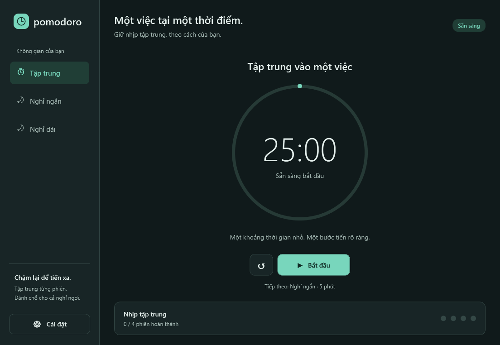

# Pomodoro

Ứng dụng đồng hồ Pomodoro cho Windows, viết bằng **C# / WPF / .NET 10**. Giao diện tiếng Việt với ba chế độ tập trung, nghỉ ngắn và nghỉ dài.


## Tính năng

- Đồng hồ đếm ngược với vòng tiến trình, nút bắt đầu, tạm dừng, tiếp tục và đặt lại phiên.
- Thanh chọn chế độ, thông tin phiên tiếp theo và tiến trình chu kỳ 4 phiên.
- Thời lượng mặc định **25 / 5 / 15 phút**, tùy chỉnh từ **1 đến 180 phút**.
- Chuông MP3 khi hết giờ; chuyển phiên khi chuông kết thúc hoặc khi bấm nút.
- Lưu thời lượng và lựa chọn nhạc chuông qua các lần mở ứng dụng.
- Bố cục co giãn, cài đặt có cuộn, điều khiển bằng bàn phím.
- Giao diện **Sáng / Tối / Hệ thống**, xem trước tức thì và lưu lựa chọn.

## Yêu cầu

- **Windows**, vì ứng dụng sử dụng WPF.
- **.NET 10 SDK** để chạy từ mã nguồn; kiểm tra bằng `dotnet --version`.
- Nếu dùng Visual Studio: phiên bản hỗ trợ .NET 10 và workload **.NET desktop development**.

## Chạy dự án

Mở terminal tại thư mục chứa `Pomodoro.slnx`:

```powershell
dotnet restore .\Pomodoro\Pomodoro.csproj
dotnet run --project .\Pomodoro\Pomodoro.csproj
```

Hoặc mở solution bằng Visual Studio, chọn `Pomodoro` làm startup project và nhấn **F5**.

Biên dịch Release:

```powershell
dotnet build .\Pomodoro\Pomodoro.csproj -c Release
```

Kết quả nằm trong `Pomodoro/bin/Release/net10.0-windows/`. Khi chuyển bản build sang máy khác, giữ nguyên các tệp đi kèm và thư mục `Asset`; máy đích cần **.NET 10 Desktop Runtime**.

## Sử dụng

1. Chọn **Tập trung**, **Nghỉ ngắn** hoặc **Nghỉ dài**, rồi bấm **Bắt đầu**.
2. Bấm **Tạm dừng / Tiếp tục** để điều khiển bộ đếm. Nút **↺** đưa phiên hiện tại về thời lượng ban đầu và chờ bạn bắt đầu lại.
3. Mở **Cài đặt**, nhập thời lượng, chọn chuông nếu cần, rồi bấm **Lưu cài đặt**. Nút **Mặc định** chỉ điền lại các giá trị trong cửa sổ; **Hủy** không thay đổi cấu hình đang dùng.
4. Khi hết giờ, bấm **Sang phiên tiếp theo** hoặc đợi chuông phát xong. Phiên tiếp theo trong chu kỳ bắt đầu tự động.

Đổi sáng/tối trong **Cài đặt → Giao diện**. Chọn **Sáng**, **Tối** hoặc **Hệ thống** để theo giao diện ứng dụng của Windows, rồi bấm **Lưu cài đặt**. Thay đổi được xem trước ngay; **Hủy** khôi phục giao diện đã lưu. Đổi giao diện không đặt lại bộ đếm.



Chu kỳ:

```text
Tập trung → Nghỉ ngắn → Tập trung → Nghỉ ngắn
         → Tập trung → Nghỉ ngắn → Tập trung → Nghỉ dài → lặp lại
```

Nghỉ dài sau **4 phiên tập trung hoàn thành**. Chọn chế độ bằng tay hoặc đặt lại phiên không xóa số phiên đã hoàn thành trong chu kỳ. Tiến trình chu kỳ được giữ trong lần chạy hiện tại.

| Phím tắt | Thao tác |
| --- | --- |
| Space | Bắt đầu / tạm dừng khi vùng đồng hồ được chọn; trên nút, kích hoạt nút đang có focus |
| Ctrl + R | Đặt lại phiên |
| Ctrl + , | Mở cài đặt |
| Tab / Shift + Tab | Di chuyển giữa các điều khiển |
| Esc trong cài đặt | Hủy và đóng |

## Cài đặt và hành vi bộ đếm

- Cấu hình được lưu ở `%LOCALAPPDATA%/Pomodoro/settings.json`. Tệp cấu hình thiếu hoặc không đọc được không ngăn ứng dụng khởi động.
- Nhạc chuông tùy chọn được tham chiếu tại vị trí bạn chọn. Nếu tệp không còn tồn tại lúc mở ứng dụng, chuông mặc định sẽ được dùng.
- Mở cài đặt tạm dừng bộ đếm và chặn tự chuyển phiên; đóng cài đặt khôi phục trạng thái trước đó.
- Nếu chỉ đổi chuông hoặc thời lượng của chế độ khác, phiên hiện tại giữ nguyên thời gian còn lại. Đổi thời lượng của chế độ đang mở sẽ đặt lại bộ đếm và giữ trạng thái chạy / tạm dừng.
- Nếu chuông bị thiếu hoặc trình phát báo lỗi lúc hết giờ, ứng dụng chuyển sang phiên tiếp theo. Chuông mặc định là `Asset/Alarm/alarm_sound.mp3`.
- Thời gian còn lại được tính bằng đồng hồ đơn điệu; nhịp cập nhật giao diện không quyết định độ chính xác của bộ đếm.

## Cấu trúc mã nguồn

```text
Pomodoro.slnx
Pomodoro/
├── MainWindow.xaml[.cs]       Bố cục, điều khiển và điều phối chu kỳ
├── Theme.xaml                Màu sắc và kiểu điều khiển dùng chung
├── ThemeManager.cs           Bảng màu sáng/tối và theo dõi giao diện Windows
├── Controls/TimerDisplay.*    Đồng hồ và vòng tiến trình
├── CountdownSession.cs       Tính thời gian, tạm dừng và tiếp tục
├── TimerPage.cs              Vòng đời bộ đếm dùng chung cho ba chế độ
├── AppSetting.cs             Kiểm tra, đọc và lưu cấu hình
├── Alarm.cs                  Phát chuông MP3
├── Interface/ITimerControl.cs
├── Page/                     Các chế độ, màn hình hoàn thành và cài đặt
└── Asset/Alarm/              Nhạc chuông mặc định
tests/Pomodoro.RegressionTests/
docs/screenshots/
```

Các ảnh nền cũ trong `Asset/Image/` được giữ lại trong dự án. Giao diện mới sử dụng màu nền và các thành phần WPF thay cho ảnh nền.

## Kiểm tra

Chạy trên Windows với .NET 10 SDK, không cần thư viện kiểm thử bên ngoài:

```powershell
dotnet run --project .\tests\Pomodoro.RegressionTests\Pomodoro.RegressionTests.csproj
```

Bộ kiểm tra bao gồm độ chính xác thời gian, tạm dừng / tiếp tục, vòng đời trang, chuyển phiên, chuông lỗi, chu kỳ 4 phiên, nhập liệu và lưu cấu hình. Kiểm thử lưu cấu hình dùng tệp tạm, không thay đổi cài đặt cá nhân.

Xuất ảnh giao diện WPF để kiểm tra bố cục ở kích thước thường và thu gọn:

```powershell
dotnet run --project .\tests\Pomodoro.RegressionTests\Pomodoro.RegressionTests.csproj -- --render
```
